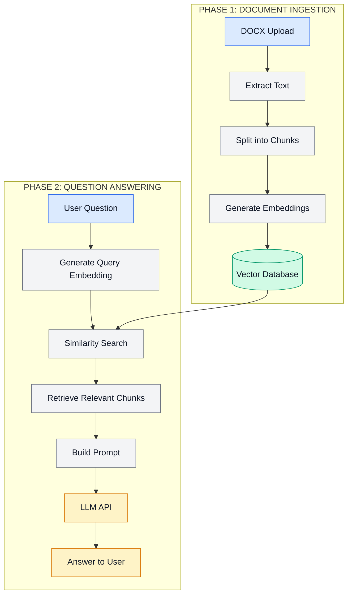

# RAG Architecture — End-to-End Notes

## Overview

RAG (Retrieval-Augmented Generation) enables a chatbot to retrieve relevant information from documents and provide it to an LLM as context before generating an answer.

A custom RAG application has two phases:

1. **Document Ingestion:** Extract, chunk, embed, and store document content.
2. **Question Answering:** Embed the question, retrieve relevant chunks, and send them to the LLM.

---

## End-to-End Architecture



---

# Phase 1: Document Ingestion

This phase typically runs when a document is uploaded or updated.

## Step 1: Upload DOCX

**Purpose:** Accept the source document from the user.

**Implementation options:**
- Java/Spring Boot REST API
- Node.js/Express API
- Private Amazon S3 bucket for file storage

**Security considerations:**
- Authenticate and authorize the uploader.
- Validate file type and size.
- Scan uploaded files for malware.
- Encrypt stored documents and enforce retention policies.

## Step 2: Extract Text

**Purpose:** Extract readable text, paragraphs, headings, and tables from the DOCX file.

**Implementation options:**
- Java: Apache POI
- Node.js: Mammoth

The extracted text becomes the input for chunking.

## Step 3: Chunking

**Purpose:** Split the extracted text into smaller, meaningful sections.

For example, a 50-page policy document may be split into hundreds of chunks.

**Implementation options:**
- Custom Java or Node.js code
- Split by headings, paragraphs, or token count
- Add a small overlap between neighboring chunks when useful

**Best practices:**
- Preserve heading and section context.
- Avoid splitting sentences or tables unnecessarily.
- Store document ID, chunk ID, page number, and access metadata.
- Choose chunk size based on document structure and retrieval quality.

## Step 4: Generate Embeddings

**Purpose:** Convert each text chunk into a numerical vector that represents its semantic meaning.

Example:

```text
Text:
"Employees can carry over up to five vacation days."

Embedding:
[0.12, -0.08, 0.31, ...]
```

The numbers above are illustrative.

**Implementation options:**
- OpenAI Embeddings API
- Another approved embedding service
- A locally hosted embedding model

**Important:** Chunking can be done with ordinary code. Vector embeddings normally require an embedding model.

## Step 5: Store Chunks and Vectors

**Purpose:** Store the original text, its embedding, and metadata for future retrieval.

**Database options:**
- PostgreSQL + pgvector
- Amazon OpenSearch Service
- Another vector database

Example record:

```json
{
  "documentId": "leave-policy-01",
  "chunkId": "chunk-004",
  "text": "Employees may carry over up to five vacation days.",
  "embedding": [0.12, -0.08, 0.31],
  "accessGroup": "employees"
}
```

The actual embedding must contain the full vector returned by the embedding model.

**Important:** Store the text as well as the vector, or store a secure reference to the text. The vector alone cannot provide the original passage to the LLM.

---

# Phase 2: Question Answering

This phase runs whenever the user asks a question.

## Step 6: Receive the User Question

Example:

```text
"How many vacation days can I carry over?"
```

The chat UI sends the question to the backend API.

## Step 7: Generate the Query Embedding

Convert the user's question into a numerical vector using the same embedding model used for document chunks.

**Why?**

The question vector must be compatible with the stored document vectors so the database can compare their semantic similarity.

## Step 8: Similarity Search

Search the vector database for chunks that are semantically similar to the question.

Common techniques:
- Cosine similarity
- Euclidean distance
- Inner product

The appropriate metric depends on the embedding model and database configuration.

## Step 9: Retrieve Relevant Chunks

Select the best matching passages, for example, the top 3–5 chunks.

The number is configurable and should be tuned for quality, latency, and token cost.

**Optional improvements:**
- Filter by document ID or department.
- Enforce user permissions before returning results.
- Use hybrid search combining keyword and vector search.
- Rerank candidate chunks to improve relevance.

## Step 10: Build the Prompt

Combine:
1. System instructions
2. Retrieved document excerpts
3. The user's question

Example:

```text
Instructions:
Answer using the supplied context.
If the answer is not in the context, say so.

Context:
Employees may carry over up to five vacation days.

Question:
How many vacation days can I carry over?
```

The application decides which content to include in the prompt.

## Step 11: Call the LLM API

Send the prompt to the selected foundation model.

Possible options include:
- OpenAI API
- Amazon Bedrock model APIs
- Another approved inference service

The LLM uses the question and retrieved context to generate the answer.

**Privacy note:** Retrieved text is normally sent to the model during inference. RAG does not automatically prevent data exposure or model training. Verify the provider's data handling, retention, and contractual terms.

## Step 12: Return the Answer

The backend returns the generated answer to the user through the chat UI.

Example:

```text
"You can carry over up to five vacation days."
```

The application should also handle missing context, unauthorized requests, and model errors.

---

# Important Concepts

## 1. Document Embeddings vs. Query Embeddings

| Document embeddings | Query embeddings |
|---|---|
| Generated during ingestion | Generated for each new question |
| Stored in the vector database | Used to search stored vectors |
| Reused until the document changes | Recomputed for each question |

Use compatible embedding models and vector dimensions.

## 2. RAG vs. Fine-Tuning

**RAG:**
- Retrieves relevant content at query time.
- Supplies that content to the LLM as context.
- Allows the knowledge source to be updated without retraining the LLM.

**Fine-tuning:**
- Updates model parameters through a training process.
- Is generally used to adapt behavior, style, or task performance.
- Is not required for a standard RAG implementation.

Sending content to an LLM for inference does not automatically mean the model is trained on it.

## 3. Chunking vs. Vectorization

- **Chunking:** Splits text into smaller sections.
- **Vectorization/embedding:** Converts each section into a numerical representation.
- **Vector search:** Finds stored vectors similar to the query vector.

These are three different operations.

## 4. Security Considerations

- Keep uploaded files in private storage.
- Enforce document-level authorization during retrieval.
- Send only the minimum relevant text to the LLM.
- Avoid logging confidential prompts and retrieved content.
- Configure deletion for temporary files, extracted text, indexes, and logs as applicable.
- Treat uploaded documents as untrusted input to defend against prompt injection.
- Verify model-provider data handling and retention requirements.

---

# Technology Stack Example

| Component | Example |
|---|---|
| Backend | Java + Spring Boot |
| DOCX extraction | Apache POI |
| Chunking | Custom Java code |
| Embedding model | OpenAI Embeddings API or local model |
| Vector database | PostgreSQL + pgvector |
| LLM | OpenAI API |
| File storage | Private Amazon S3 bucket |
| Authentication | Application authentication and authorization |
| Deployment | AWS Lambda or another suitable compute service |

This is one possible architecture; equivalent Node.js components can be used.

---

# Final Revision Flow

```text
DOCUMENT INGESTION

DOCX
  -> Extract Text
  -> Chunk Text
  -> Generate Chunk Embeddings
  -> Store Text + Vectors + Metadata


QUESTION ANSWERING

User Question
  -> Generate Query Embedding
  -> Similarity Search
  -> Retrieve Authorized Relevant Chunks
  -> Build Prompt
  -> Call LLM
  -> Return Answer
```

**One-line summary:**

DOCX -> Text -> Chunks -> Embeddings -> Vector DB -> Question Embedding -> Similarity Search -> Relevant Chunks -> Prompt -> LLM -> Answer
